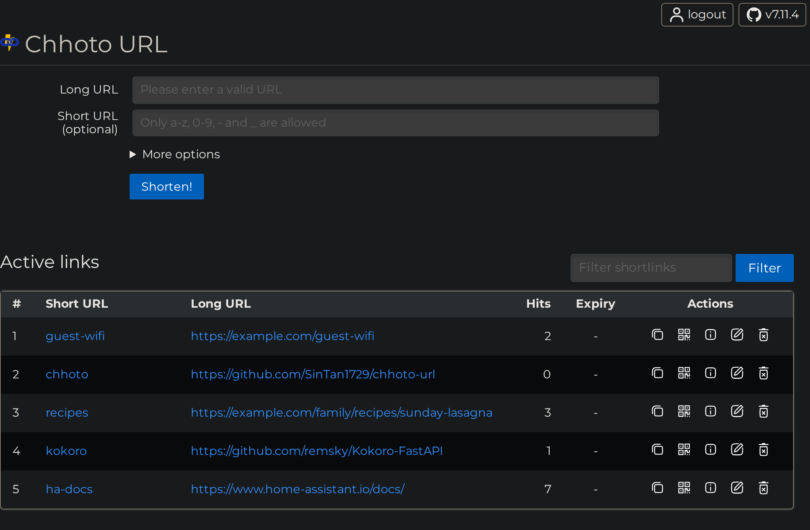

# Chhoto URL for Home Assistant

[Chhoto URL](https://github.com/SinTan1729/chhoto-url) by SinTan1729 is a simple, fast, self-hosted URL shortener written in Rust, with no unnecessary features.

This app runs it inside Home Assistant. It is a thin wrapper around the official `sintan1729/chhoto-url` Docker image.

## Highlights

- Create short links with your own name or a random one.
- See hits per link, set an expiry time, edit links, and show a QR code for any link.
- Opens from the Home Assistant sidebar, or directly on port `4567`.
- Optional JSON API for scripts and the command line.
- Links and the admin login are kept in the app's storage, so they survive restarts and updates.

## Requirements

- Home Assistant on `amd64` or `aarch64`.
- For short links that work outside your home: A public URL that forwards to port `4567` (set it as **Public Site URL**).

## Installation

1. If not already done in HA, add this repository (`https://github.com/YaannnTech/HA-Apps`) to **Settings → Apps → Install Apps → ⋮ → Repositories → Add**, or simply press this button:  

2. Install **Chhoto URL**.
3. (Optional) Set an **Admin Password** on the Configuration tab.
4. Start the app, then open it from the **Chhoto URL** entry in the sidebar, or at `http://HOME_ASSISTANT_IP:4567/`.

## Settings

All settings are on the app's **Configuration** tab:

| Setting | What it does |
| --- | --- |
| **Admin Password** | Optional. Password used to add, list, or delete short links. Leave it blank to allow open access to everyone. |
| **Public Site URL** | Optional. Base URL used for the short links, e.g. `https://s.example.com`. Defaults to Home Assistant's host (from its internal URL, else the host IP) plus this app's port, e.g. `http://homeassistant.local:4567`. |
| **API Key** | Optional. Enables Chhoto URL's JSON API and CLI usage. |
| **Allow public link creation** | Lets anyone create short links without the admin password. |
| **Enable WAL database mode** | Recommended for better performance; the database already lives in the app's persistent storage. |
| **Redirect Method** | `Permanent` (308, default) or `Temporary` (307). |

Optional settings without a value are hidden; enable **Show unused optional configuration options** on the Configuration tab to see them.

## Related links

- [Chhoto URL upstream repository](https://github.com/SinTan1729/chhoto-url)
