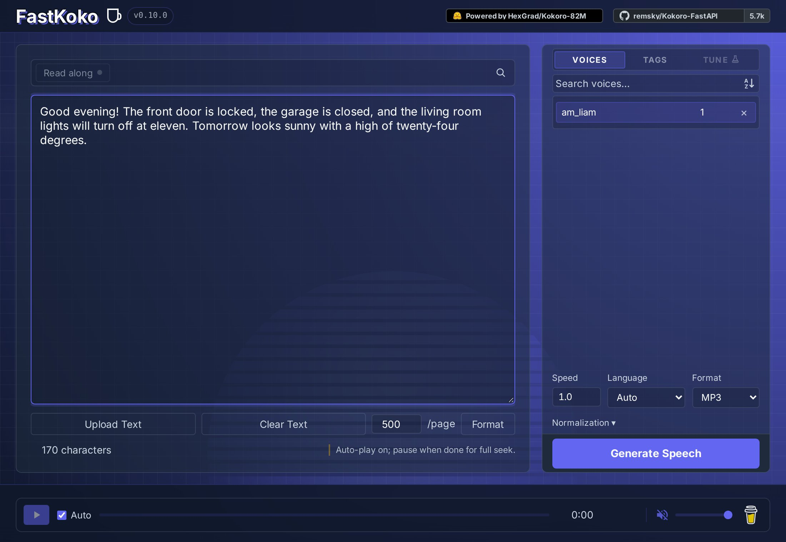

# Kokoro-FastAPI for Home Assistant

[Kokoro-FastAPI](https://github.com/remsky/Kokoro-FastAPI) by remsky is a text-to-speech server for the [Kokoro-82M](https://huggingface.co/hexgrad/Kokoro-82M) voice model.

This app runs it locally on your Home Assistant host, so spoken replies never leave your network. It is a wrapper around the work the Kokoro-FastAPI folks did. Use it with the [Kokoro TTS HACS integration](https://github.com/beecho01/Kokoro-TTS) to give Assist and your automations a natural voice.

## Highlights

- Runs fully offline on the CPU, no cloud account needed.
- 72 voices for American and British English, Spanish, French, Hindi, Italian, Japanese, Brazilian Portuguese and Mandarin Chinese.
- Web UI to try voices, mix them and tune the speed.
- OpenAI-compatible speech API (`/v1/audio/speech`) with MP3, Opus, AAC, FLAC, WAV and PCM output.
- Optional SSML support for pauses and other speech controls.

## Requirements

This app runs Kokoro on the CPU, so it needs a fast host. To speak a reply without interruptions, the CPU has to generate audio faster than it plays. If it can't, you hear pauses in long replies, even in the middle of words.

| CPU | Generation speed | Long replies |
| --- | --- | --- |
| Intel Core i3-7100U (2 cores) | About 0.9x real time | Pauses |
| AMD Ryzen 7 PRO 6860Z (8 cores) | About 3x real time | Smooth |

- **Memory**: Plan for at least 2.5 GB of free RAM for this app, on top of what Home Assistant already uses. It uses about 1 GB when idle and about 2 GB while speaking. In a test with a 2 GB limit and no swap, it ran out of memory.
- **Disk**: The image needs about 4.5 GB.
- **Architecture**: Home Assistant on `amd64` or `aarch64`. 32-bit systems are not supported.
- **Raspberry Pi**: Not recommended. A Pi has not been tested, but a 4-core limit on a much faster ARM laptop only just reached 1x real time, so expect a Pi 5 to fall below that and a Pi 4 to be slower still.

On slower hosts, you can run [Kokoro-FastAPI](https://github.com/remsky/Kokoro-FastAPI) on a faster machine in your network and point the Kokoro TTS integration to it, or use a lighter voice engine such as Piper.

## Installation

1. If not already done in HA, add this repository (`https://github.com/YaannnTech/HA-Apps`) to **Settings → Apps → Install Apps → ⋮ → Repositories → Add**, or simply press this button:  

2. Install **Kokoro-FastAPI**.
3. Start the app and wait for the model to finish loading.
4. Add and configure the [Kokoro TTS HACS integration](https://github.com/beecho01/Kokoro-TTS).

Click **Open Web UI**, or open `http://HOME_ASSISTANT_IP:8880/web/` to try voices in the Kokoro-FastAPI web UI.

## Settings

All settings are on the app's **Configuration** tab:

| Setting | What it does |
| --- | --- |
| **API Log Level** | How much detail Kokoro writes to the app log: `Debug`, `Info`, `Warning` or `Error`. Only `Debug` logs every HTTP request, including Home Assistant's health checks every few seconds. |
| **Default Voice** | Default Kokoro voice identifier. Use **Open Web UI** to browse and preview voices. |
| **Enable Web UI** | Serves Kokoro's web UI at `http://HOME_ASSISTANT_IP:8880/web/`. |
| **Support SSML** | Enables Speech Synthesis Markup Language, including pauses and other supported speech controls. |

## Related links

- [Kokoro-FastAPI](https://github.com/remsky/Kokoro-FastAPI)
- [Kokoro TTS HACS integration](https://github.com/beecho01/Kokoro-TTS)
