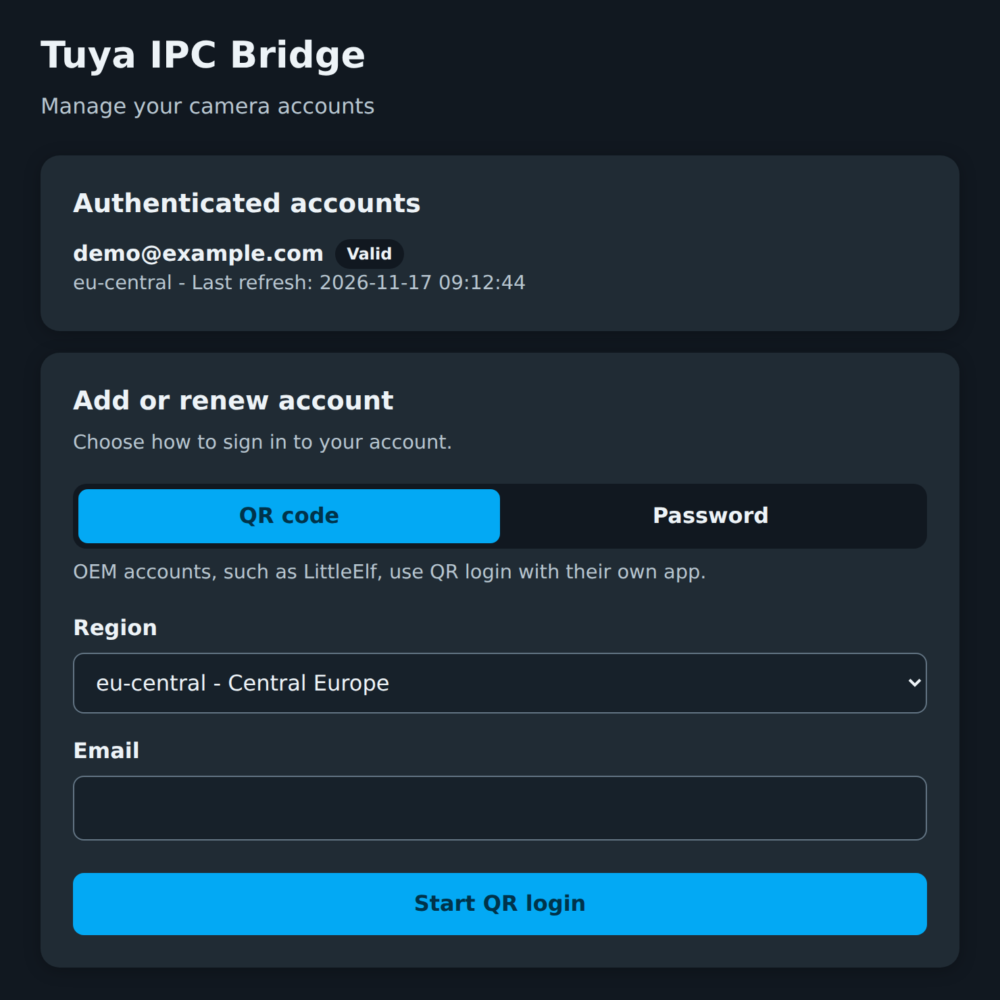

# Tuya IPC Bridge for Home Assistant

Bridges the streams of Tuya Smart / Smart Life cameras to standard RTSP, so you can add them to Home Assistant like any other RTSP camera, with the built-in **generic camera** integration or **go2rtc**.

The app wraps [tuya-ipc-terminal](https://github.com/seydx/tuya-ipc-terminal) by seydx, a Go CLI that signs in to Tuya's cloud, discovers your cameras and does the actual bridging. It uses a prebuilt binary from the maintained [fork](https://github.com/YaannnTech/tuya-ipc-terminal), which adds RTSP and WebRTC fixes to the original project.

## Why does this exist?

Not all "Tuya" cameras work with the native Home Assistant Tuya integration, and not all of them support ONVIF/RTSP out of the box. Many cameras lack that setting, especially devices that need another Tuya-variant app (e.g. "LittleElf"). The only option then is their browser-based IPC stream, which is what [seydx/tuya-ipc-terminal](https://github.com/seydx/tuya-ipc-terminal) uses.

## Highlights

- Web UI in the Home Assistant sidebar for adding accounts: QR-code login or email/password (OEM accounts such as LittleElf: QR only).
- Finds your cameras and starts the RTSP server as soon as an account is signed in.
- Home Assistant notifications when no account is set up yet, or when a session expires and needs a new login.

## Requirements

- A Tuya Smart, Smart Life or Tuya-based OEM app account with your cameras.
- Home Assistant on `amd64` or `aarch64`.

## Installation

1. If not already done in HA, add this repository (`https://github.com/YaannnTech/HA-Apps`) to **Settings → Apps → Install Apps → ⋮ → Repositories → Add**, or simply press this button:  

2. Install **Tuya IPC Bridge**.
3. Start the app, **then** add your account in its web UI.

## Settings

- **RTSP Port** (Configuration tab): Port the bridged RTSP server listens on. The default is `8553`.
- Tuya accounts are added in the app's web UI with QR-code or password login.

See the **Documentation** tab for setup, camera URLs, options and troubleshooting.
